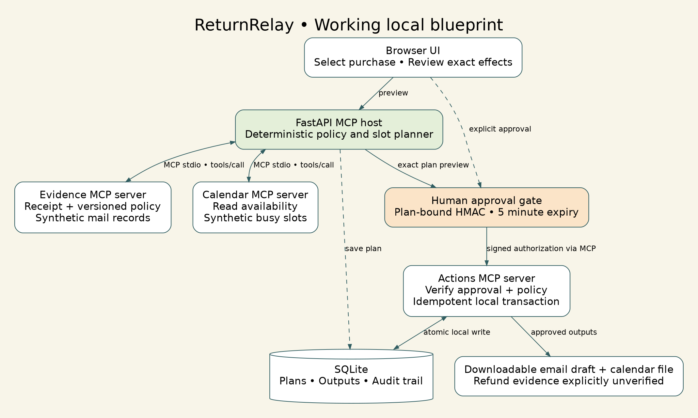
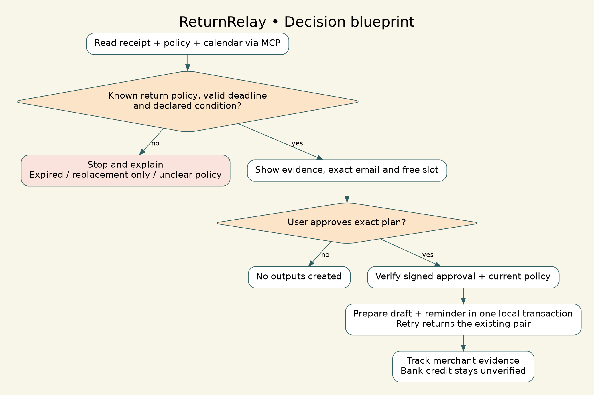

# ReturnRelay

**Team SynError · Track 1: Make MCP Matter · wHACKiest 2026**

ReturnRelay prepares an evidence-backed return request and a conflict-free calendar reminder from purchase receipts, merchant policy and calendar availability. The user reviews the exact effects before the host authorizes the action service. Every demonstration merchant, purchase, policy and message is fictional.

## Start here

This is a working local prototype with **real Model Context Protocol communication**, three MCP server processes, a browser interface, SQLite persistence, downloadable email drafts and calendar files, and executable tests. It needs no API keys or paid services after installing dependencies. It is a bounded deterministic host, not an implemented LLM agent. Live Gmail, Calendar, merchant and banking integrations are not included.

### Run on Windows

Install Python 3.11 or newer. Extract the ZIP, open PowerShell in this `returnrelay` folder, then run:

```powershell
py -m venv .venv
.\.venv\Scripts\python.exe -m pip install -r requirements.txt
.\.venv\Scripts\python.exe host.py
```

### Run on macOS or Linux

```bash
python3 -m venv .venv
.venv/bin/python -m pip install -r requirements.txt
.venv/bin/python host.py
```

Open **http://127.0.0.1:8000**. Keep the terminal open. Stop with Ctrl+C. No separate frontend build, Node.js installation or cloud account is needed. If port 8000 is busy, run `python -m uvicorn host:app --host 127.0.0.1 --port 8001` with the virtual environment's Python and open port 8001 instead. Use one worker.

The scenario clock is deliberately fixed to **24 November 2026 at 10:00 IST**, so the demonstration remains reproducible. Approval expiry uses the real clock. The production design must use current merchant-local time, explicit cutoff semantics and fresh policy evidence.

## The problem and proposed solution

A buyer may know they want to return a product but still need to locate the receipt, understand whether the policy allows refunds or only replacements, find time before the cutoff, contact support, and follow the eventual refund. These steps span apps. A reminder alone does not establish eligibility, prepare a request or distinguish a merchant's processing notice from money credited to an account.

ReturnRelay's product hypothesis is that a narrow, explainable workflow with approval and evidence will earn more trust than a broad assistant that silently acts. Initial users are frequent online shoppers among students and early-career professionals. No customer interviews, market-size study, measured time savings or real recovered refunds are claimed.

The distinctive combination is an **evidence-linked action plan**: receipt and policy version, policy decision, free preparation slot, exact outgoing draft, exact effects, approval binding and a replay-safe action record. This is a proposed differentiation, not a claim of a patent, global first or exclusive capability.

For scale context, NRF and Happy Returns estimated that 19.3% of U.S. online sales would be returned in 2025. The underlying merchant survey covered 358 ecommerce professionals at large U.S. merchants. This is survey-based context, not an Indian market-size estimate or evidence that deadlines were missed. Source: https://nrf.com/media-center/press-releases/consumers-expected-to-return-nearly-850-billion-in-merchandise-in-2025 (15 October 2025).

## Two minute demonstration

1. Select **Everyday headphones / RR-1042 / INR 2,499**. Leave condition as unused with packaging and accessories.
2. Click **Preview return plan**. No action output exists yet. Show receipt `MAIL-1042` and policy `POL-A-v1`.
3. Explain the demo rule: delivered 19 November plus seven calendar days gives **26 November, 23:59 IST**. These are fictional merchant terms, not a general consumer-law rule.
4. Show **24 November, 18:00–18:30 IST**. The planner skips the occupied 17:00–18:00 period. This is time to prepare the return, not a merchant pickup reservation.
5. Tick approval and the calendar-failure checkbox. Approve. The server fails the local transaction and creates neither output.
6. Untick failure and approve again. The service creates one local draft and reminder. Download `.eml` and `.ics` and open them in compatible mail/calendar software. Importing a calendar file is a separate user action.
7. Click retry. The existing pair returns with `replayed: true`; the output count stays one.
8. Select **RR-1044** and preview. The replacement-only policy blocks a refund return. RR-1043 demonstrates an expired window. RR-1045 demonstrates an unclear policy. Changing item condition also stops the workflow for review.
9. On the prepared outputs, check sample refund evidence. The merchant says processed, but **bank credit verified remains false**. No money has moved.
10. Expand the MCP trace to show initialized servers, tool discovery and actual `tools/call` requests.

## Working blueprint





Editable diagram sources are in `docs/architecture.dot` and `docs/workflow.dot`. If Graphviz is installed, regenerate with `dot -Tpng docs/architecture.dot -o docs/architecture.png`.

### Data path

The browser calls the FastAPI host. The host connects as a client to each role-scoped MCP server using official Python SDK stdio transport. The evidence server returns structured sample receipts and versioned policy. The calendar server returns sample occupied periods. Host rules evaluate eligibility, calculate the cutoff and select a 30-minute free period. The host persists and displays a complete plan. A user approval POST lets the host sign a short-lived authorization for that exact stored plan. The actions MCP server verifies it and writes local outputs in a single SQLite transaction. The UI downloads those outputs through the host.

### MCP contract

| Server | Tool | Access | Result |
|---|---|---|---|
| evidence | `list_orders()` | Read | Synthetic purchase records |
| evidence | `get_evidence(order_id)` | Read | Receipt and policy with source IDs |
| evidence | `get_refund_evidence(order_id)` | Read | Merchant notice, bank verification false |
| calendar | `get_busy_slots()` | Read | Synthetic occupied intervals |
| actions | `prepare_approved_outputs(plan_id, approval_token, fail_calendar)` | Local write | Draft and reminder, or a blocking error |

The official SDK handles initialization, capability negotiation, JSON-RPC serialization and tool discovery. The tested SDK version is **1.29.0** and the observed negotiated protocol is **2025-11-25**. Newer SDK major versions use different APIs. Do not upgrade the pinned major version without adapting and retesting. The `fail_calendar` flag exists only to demonstrate recovery.

### Data model

| SQLite table | Key | Purpose |
|---|---|---|
| plans | `id` | Exact preview including evidence, effects and expiry |
| actions | `id`, unique `plan_id` | One local output pair per plan |
| audit | `seq` | Ordered local record of previews and approved output creation |

The local audit table is inspectable, not tamper-proof. SQLite and fixtures share a trusted-machine boundary. A user who controls the process or database can bypass local protections. This prototype does not claim production isolation.

## What works and what comes next

| Capability | Delivered now | Next build round |
|---|---|---|
| MCP | Three actual SDK servers, discovery and tool calls | Provider adapter contracts and conformance checks |
| Evidence | Four fictional receipts and three policy types | User-forwarded receipts, then narrow Gmail OAuth access |
| Reasoning | Deterministic rule and slot planner | Optional Bedrock model for schema-constrained extraction and explanations |
| User control | Exact preview, approval checkbox, HMAC binding | Authenticated per-user sessions and isolated executor |
| Actions | Local email draft and `.ics` reminder | Gmail drafts and a dedicated Calendar, after OAuth |
| Recovery | Local atomic output pair and idempotent retries | Per-provider idempotency keys, durable outbox and reconciliation |
| Refund tracking | Clearly labelled fictional merchant notice | Consented receipt evidence, explicit user confirmation of bank credit |
| Deployment | Localhost app and Dockerfile | AWS deployment after authentication and persistent data design |
| Voice | No voice integration | Optional ElevenLabs readout of the exact plan |

MCP is useful here because the host can discover typed capabilities and keep data access separate from actions. A direct API implementation could perform the same business workflow. MCP's value is the reusable, replaceable server interface and policy boundary, rather than an exclusive ability to solve returns.

## Approval and failure controls

- Read-only services never receive the host's signing key. The action service verifies approval for the full stored plan and checks expiry and current policy.
- Approvals last at most five minutes. Plans last thirty minutes. Changes require a fresh preview and approval.
- Receipt prose stays inert. It cannot choose recipients, add tools, change policy or authorize writes. The delivered host has no LLM interpreting receipt instructions.
- Only declared unused items with packaging qualify for the sample return flow. Unknown policies, expired deadlines and replacement-only terms stop for human review.
- The browser uses an ephemeral token for POSTs and the server restricts accepted Host headers. This is a localhost demonstration, not a full authentication system. Tokens can be read by local processes, so do not expose the service publicly.
- Unique `plan_id` plus a SQLite write transaction prevents duplicate local output pairs. A simulated calendar failure rolls back the whole pair.
- Real mail and calendar APIs cannot share this SQLite transaction. Production requires an outbox with per-step state, provider IDs, compensating deletion where safe, and reconciliation before retries after ambiguous timeouts.
- No merchant submits, automatic emails, payments, arbitrary web browsing, credential collection, pickup bookings or verified refunds occur.

## Tests

Use your environment's Python in place of `python` below:

```bash
python -m unittest discover -s tests -p test_core.py -v
python -m tests.test_mcp
python -m tests.test_api
```

The core suite covers 12 cases: cutoff calculation and conflict avoidance, expired window, replacement-only policy, unknown policy, condition review, missing approval, changed plan, expired approval, duplicate retry, simulated failure, changed policy and inert malicious receipt text. The integration test starts all three real MCP services and checks tool calls and replay behavior. The API test checks the request token, approvals, failure recovery and downloadable EML/ICS outputs. Browser rendering could not be automated in the build environment; manually follow the demonstration steps before recording. Tests use temporary databases. Some installed SDK dependencies emit warnings without failing the tests.

## File guide

| Path | Contents |
|---|---|
| `host.py` | FastAPI routes, MCP sessions, user approval boundary, downloads |
| `mcp_service.py` | Evidence, calendar and action server roles |
| `core.py` | Policy, planning, signatures, SQLite and idempotency |
| `static/index.html` | Browser interface, no build step |
| `data/fixtures.json` | Clearly fictional demonstration data |
| `tests/` | Domain, protocol and API checks |
| `docs/` | Blueprints, technical plan, demo guidance and submission checklist |
| `Dockerfile` | Reproducible local container packaging |

To reset the demonstration, stop the app, remove `data/demo.db` if present, and restart. Do not delete any real user database. A new signing key is generated at startup. No keys or sample runtime database ship in the ZIP.

## 24 hour implementation plan

| Hours | Work | Acceptance check |
|---|---|---|
| 0–3 | Validate schema, receipt ingestion and user condition capture | Every extracted field points to evidence |
| 3–7 | Live Gmail draft adapter or user-forwarded receipt fallback | One sample account reads only approved data |
| 7–11 | Calendar adapter and cutoff normalization | No reminder after cutoff or within busy periods |
| 11–16 | Approval UI, outbox and duplicate handling | Repeat approval creates no duplicate remote effect |
| 16–20 | Optional Bedrock extraction, strict schema validation | Malformed or uncertain fields stop for review |
| 20–24 | Failure tests, recording and deployment rehearsal | Happy path and three stop cases run reproducibly |

If OAuth consent or review blocks live access, keep the working forwarded-receipt/local-file path. Ship one complete trustworthy workflow before adding merchant automation.

## Business and measurement hypotheses

Start with a **30-person opt-in campus pilot**, not a claim of 30 acquired users. A broader first outreach pool of 1,000 students and professionals is a planning assumption, not a measured market. Compare manual preparation and assisted preparation for the same task. Measure median preparation time, eligible-case completion, missed deadlines, plan corrections, duplicate outputs and cancellations. Target preparation below two minutes and zero unauthorized writes, and measure the result before claiming success. Receipt face value is never revenue or recovered money.

Test a free allowance of three active purchases and a proposed **INR 49/month** tier. At 100 paying users that would be INR 4,900/month gross before costs, tax and acquisition. Neither conversion nor price acceptance has been validated. Main costs would be model usage, hosting, storage and support. Set usage limits and measure cost per successful case before a larger launch. No advertising use or sale of receipt data is proposed. Potential partnerships with campus communities and consumer-support organizations remain unconfirmed.

AWS is a proposed extension: Bedrock for extraction, S3 for encrypted evidence objects, and DynamoDB plus a worker/outbox for execution state. No AWS or ElevenLabs service is integrated in this package, and sponsor-prize eligibility must not be claimed on architecture slides alone.

## Sources and submission

See [submission checklist](docs/SUBMISSION_CHECKLIST.md), [technical blueprint](docs/BLUEPRINT.md), and [judge questions](docs/JUDGE_QA.md). Event requirements were checked on 24 November 2026 against the supplied screenshots and the linked CodeRIT event website:

- Event FAQ: https://whackiest-2026.vercel.app/ (questions 6–13, 17).
- Official MCP server concepts: https://modelcontextprotocol.io/docs/develop/build-server
- Official Python SDK: https://github.com/modelcontextprotocol/python-sdk
- Google Calendar insertion contract for future adapter: https://developers.google.com/workspace/calendar/api/v3/reference/events/insert

The official PPT template has exactly eight slides. Keep its slide count and branding. The submitted video is **3–5 minutes**, while the separate live online pitch may have a different duration. Verify any new organizer announcement before submission.
# mcpserver

