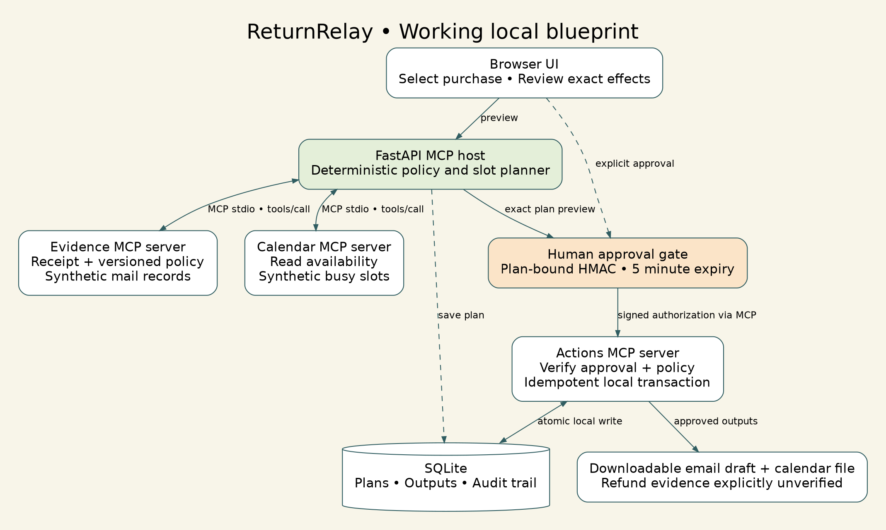
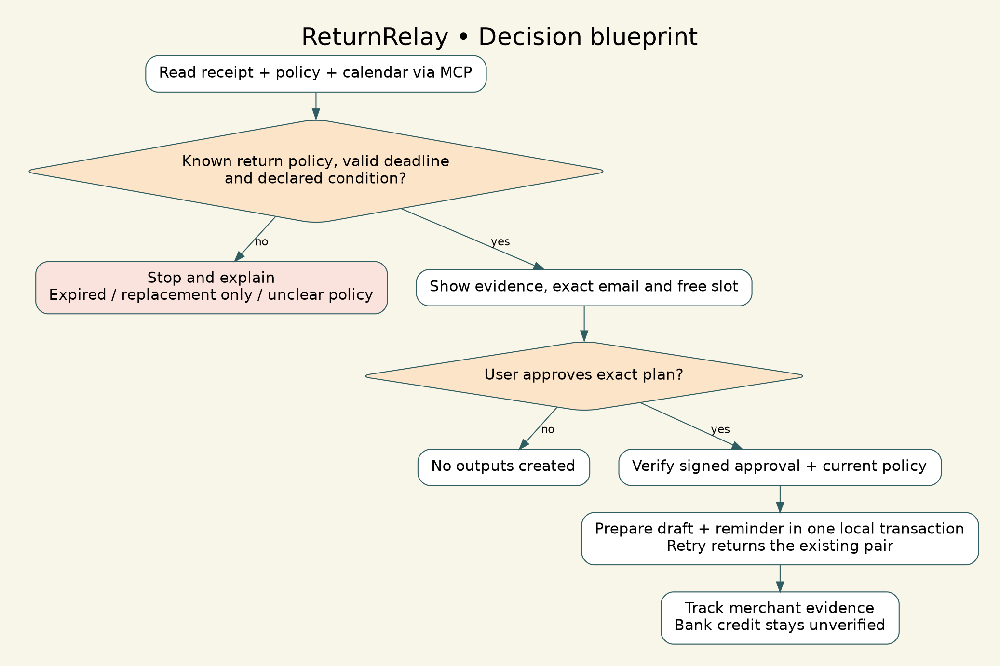

# ReturnRelay technical blueprint

## Scope and acceptance

The round-one build proves a complete local workflow. It accepts a selected purchase and the user's declared item condition, reads evidence and calendar data through real MCP servers, prepares a plan, asks for consent, verifies an authorization tied to that exact plan and produces a downloadable email draft plus calendar reminder. It never claims a merchant has accepted the return or a refund has settled.

Acceptance: one eligible case succeeds after approval, duplicate retries return the same output pair, failures leave no partial local pair, and expired or unsupported policies produce clear stop reasons.

## Components and trust boundaries

The browser is the user interface. FastAPI owns the trusted local approval route and deterministic planning. Three MCP server subprocesses expose typed tools. Only the action server receives the approval signing key. All components run under the same trusted local user, so process separation is an architectural demonstration rather than a hardened sandbox.

Evidence and calendar services supply read-only fixture data. The evidence service never interprets instructions in receipt text. An optional future model may propose structured fields but will not mint approvals, choose unapproved tools or write directly to provider APIs. Policy rules and the approval boundary stay outside the model.

SQLite holds plans, output pairs and an ordered audit table. `BEGIN IMMEDIATE` plus a unique `plan_id` protects local duplicate writes. A single transaction either saves the email draft and reminder as one JSON result or saves nothing. This guarantee applies only to local output preparation.

## Eligibility algorithm

1. Resolve the order by ID and obtain its versioned policy.
2. Require the declared condition `unused_with_packaging`.
3. Require policy type `return` and an explicit day count. Replacement-only and unknown policy records stop.
4. Apply the fixture's explicit rule: delivery date plus N calendar days at 23:59 Asia/Kolkata. This rule belongs only to these fictional policies.
5. Compare against the fixed demonstration clock. An expired window stops.
6. Search 30-minute preparation slots from 17:00 on the scenario date, rejecting overlap with occupied intervals and any slot ending after the deadline. Search at most 48 candidate starts. If none works, ask for manual scheduling.
7. Assemble the exact recipient, subject, draft body, reminder slot, evidence IDs and two effects into a stored plan.

Production must model merchant-local time zones, holidays if relevant, policy exclusions, explicit condition questions and inclusive/exclusive cutoff semantics. A model's guess is not sufficient to establish a deadline.

## Approval sequence

1. User sees the complete stored plan and checks the approval box.
2. Browser POSTs its plan ID and explicit approval flag to the host, including a session token.
3. Host loads the stored plan and signs a payload containing its ID, full-plan digest and real-time expiry, at most five minutes ahead.
4. Host invokes the action tool through MCP with the plan ID and signed authorization. No signing key or approval token is returned to the browser.
5. Action service loads the same stored plan, verifies the signature and expiry, then checks the policy snapshot and eligibility again.
6. If the plan already has an output pair, return it with `replayed: true`. Otherwise create both local outputs atomically.
7. User downloads files and decides whether to import or send them using their own software.

The full-plan digest covers the recipient, body, slot and evidence. A modified plan fails authorization. In production, approval must also bind authenticated user identity and provider scopes. There is no network authentication system in the local demo.

## State interpretation

| State | Meaning | Permitted next step |
|---|---|---|
| Read | Evidence fetched, no write output | Build plan or block |
| Blocked | Policy, condition or deadline prevents automatic preparation | User seeks merchant review |
| Preview | Exact plan persisted for review | Explicit approval or abandon |
| Prepared | Local draft and calendar output pair exists | Download or inspect existing result |
| Merchant says processed | Sample message reports processing | Seek independent confirmation |
| Bank credit verified | Not implemented in this prototype | Future consented user confirmation |

A preview record and local audit entry are internal persistence. “No writes before approval” in the pitch refers specifically to user-facing action outputs and external side effects, not an assertion that no database row is written.

## API contracts

| Route | Purpose |
|---|---|
| `GET /api/bootstrap` | Orders, local outputs, request token and MCP trace |
| `POST /api/plan` | `{order_id, condition}` to preview or stop |
| `POST /api/approve` | `{plan_id, approved, fail_calendar}` to authorize exact outputs |
| `GET /api/refund/{order_id}` | Sample merchant processing evidence |
| `GET /api/download/{action_id}/eml` | RFC 822 draft with X-Unsent header |
| `GET /api/download/{action_id}/ics` | Calendar event in UTC timestamps |
| `GET /api/audit` | Local audit trail and sanitized tool trace |

Use `http://127.0.0.1:8000/docs` for generated OpenAPI documentation. Request tokens rotate on restart. Trace records contain tool names and status, not approval tokens. Local receipt data is still present in the database and should not be shared for real users without a privacy design.

## Production integration plan

For Gmail, begin with user-forwarded evidence or explicit selection rather than mailbox-wide collection. A later OAuth adapter should request only the data scopes actually required and create drafts by default. For Calendar, create a dedicated app calendar with the narrowest supported scopes and use provider IDs to reconcile retries. Merchant portals often lack a public return API, so the first live product should prepare a request and give the user a handoff link instead of claiming automated pickup booking.

For AWS, an optional Bedrock adapter can extract an allowlisted schema from receipt text. A deterministic validator checks required fields and source locations. Store private evidence in encrypted S3 objects with retention controls. Use per-user execution state in DynamoDB and a durable worker/outbox. These cloud pieces are a proposed design and are not deployed.

Real external operations need per-step records such as `draft_created`, `calendar_pending`, `calendar_created`, `needs_reconciliation`. On timeout, inspect provider IDs before retrying. If one step fails, preserve the successful provider ID and offer a safe retry or explicit compensation. Never describe this as a distributed atomic transaction.

## Feasibility and evaluation

The demo requires a laptop with Python and installs open-source dependencies. It has no model API spend. Production pricing and infrastructure costs require measurement, and no cloud cost estimate is presented as a quote.

Run the three test commands in README. Then manually verify the browser workflow and exported files before the final video. Automated browser launch was unavailable in the build environment. Twelve domain cases, a real stdio integration and API/download checks passed. These checks demonstrate local behavior and do not establish production security or provider reliability.
